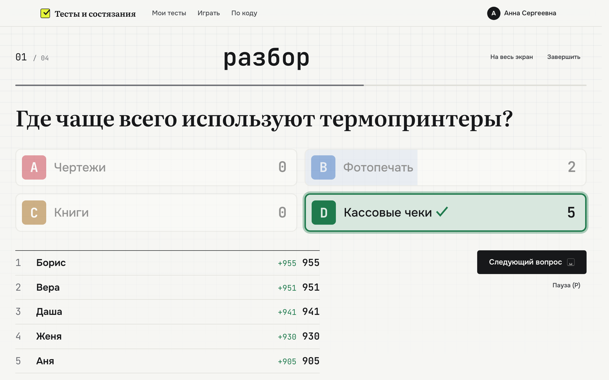
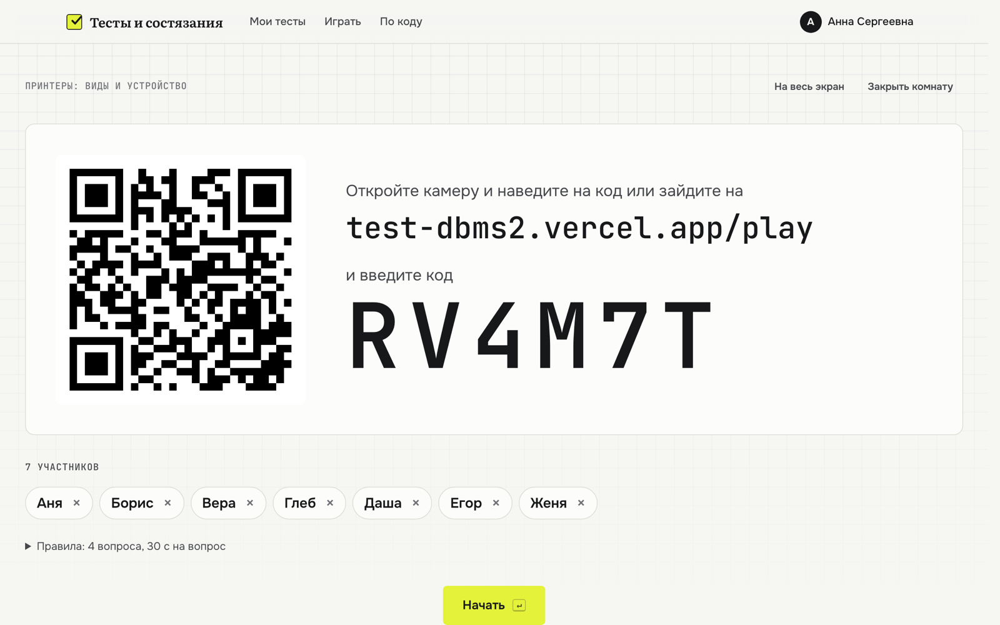
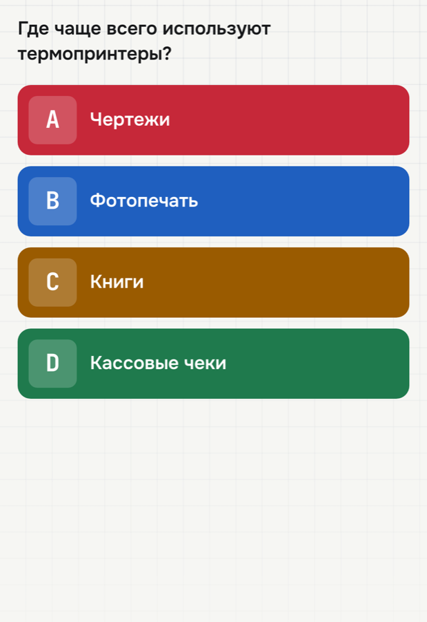
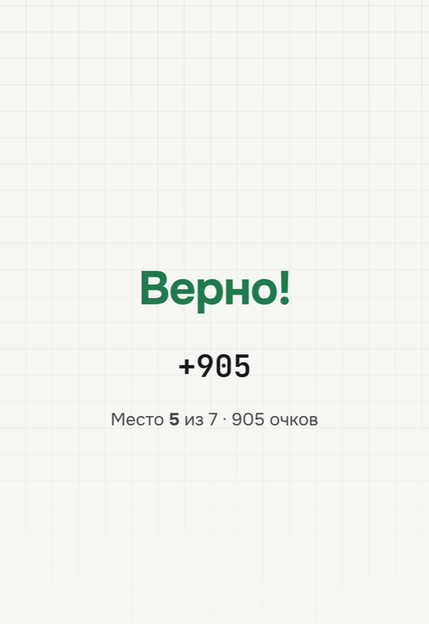
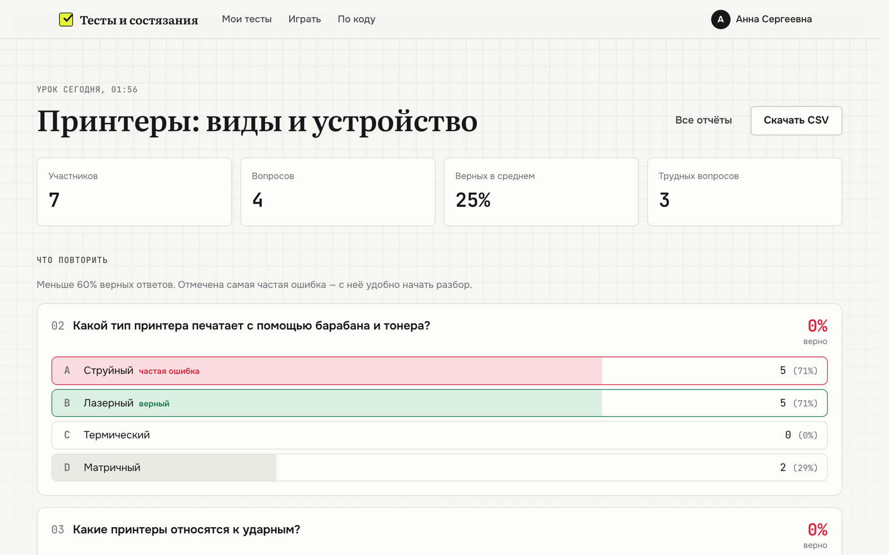
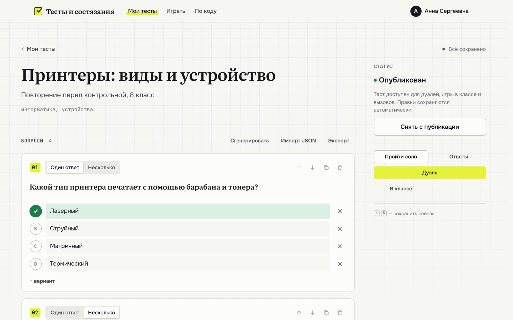
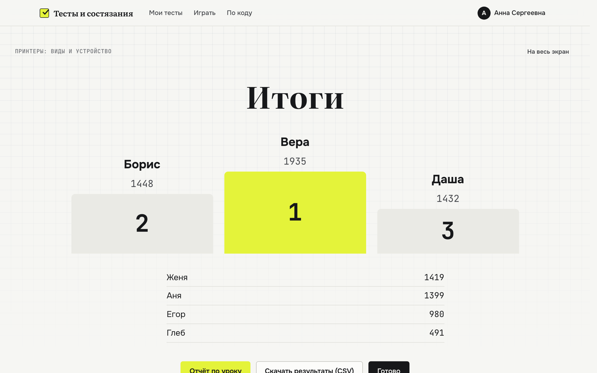
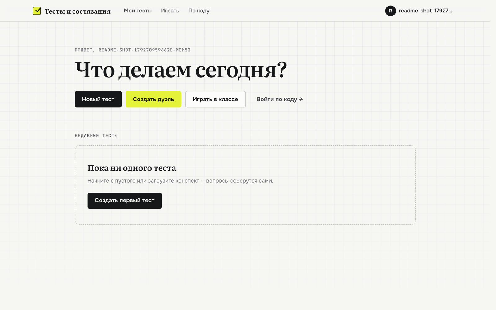
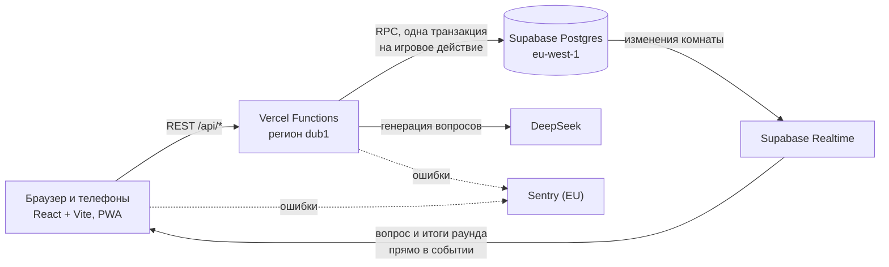

<div align="center">


# Тесты и состязания

**Тест из конспекта, статьи или просто по теме — за минуту.<br>
Готовьтесь в одиночку, вызывайте друзей на дуэль или проведите игру на уроке с телефонов.**

[**Открыть сайт →**](https://test-dbms2.vercel.app) &nbsp;·&nbsp; [Возможности](#возможности) &nbsp;·&nbsp; [Как устроено](#как-устроено) &nbsp;·&nbsp; [Быстрый старт](#быстрый-старт)

[](https://github.com/senLoveY/test-dbms2/actions/workflows/ci.yml)


<br>



<sub>Урок в режиме «Класс»: проектор показывает правильный ответ, сколько человек выбрало каждый вариант, и топ-5.</sub>

</div>

---

## Возможности

<table>
<tr>
<td width="50%" valign="top">

### ✍️ Создание тестов
- **Генерация** через DeepSeek: из файла (PDF, DOCX, PPTX, TXT), по ссылке на статью или **по теме** без материала
- Короткие варианты ответов, правдоподобные ловушки, повторная попытка сократить длинные формулировки
- Удобный редактор: автосохранение, проверка ошибок, горячие клавиши
- Импорт и экспорт в JSON

</td>
<td width="50%" valign="top">

### 📚 Подготовка
- **Соло** с проверкой сразу после ответа и разбором
- Прогресс по каждому вопросу: «выучено» — три верных ответа подряд, кнопка «Повторить слабые места»
- **Экзамен** с общим таймером и оценкой 5/4/3/2
- Длинным вопросам добавляется время на чтение
- Работает как приложение на телефоне (PWA), открытые тесты — без сети

</td>
</tr>
<tr>
<td width="50%" valign="top">

### ⚔️ Вместе
- **Дуэль** по коду комнаты: таймер, очки за скорость, реванш
- **Вызов по ссылке**: друзья проходят те же вопросы когда удобно, потом рейтинг и сравнение по вопросам
- Поделиться тестом: пройти, вызвать автора или сохранить копию себе
- Карточка результата для чатов и сторис

</td>
<td width="50%" valign="top">

### 🏫 Класс
- Вопросы на **проекторе**, ответы **с телефонов**: вход по QR-коду, без аккаунта, до 60 человек
- Распределение ответов, топ-5 и пьедестал
- **Отчёт урока**: что повторить, самая частая ошибка, результаты каждого ученика, CSV
- Выдерживает класс, который отвечает в одну и ту же секунду

</td>
</tr>
</table>

## Как это выглядит

<table>
<tr>
<td colspan="2"><br><sub><b>Лобби урока</b> — ученики сканируют QR-код и появляются на экране</sub></td>
</tr>
<tr>
<td width="50%"><br><sub><b>Телефон ученика</b> — те же буквы и цвета, что на проекторе</sub></td>
<td width="50%"><br><sub><b>После ответа</b> — очки за раунд и место в классе</sub></td>
</tr>
<tr>
<td width="50%"><br><sub><b>Отчёт урока</b> — какие вопросы разобрать и на какую ловушку попались</sub></td>
<td width="50%"><br><sub><b>Редактор</b> — генерация, импорт, публикация в один клик</sub></td>
</tr>
<tr>
<td width="50%"><br><sub><b>Итоги</b> — пьедестал и таблица класса</sub></td>
<td width="50%"><br><sub><b>Главная</b> — для гостей с кодом от учителя есть вход без аккаунта</sub></td>
</tr>
</table>

## Как устроено



- **Игровые действия атомарны.** Старт, ответ, показ ответа и переход к вопросу — функции Postgres, каждая одной транзакцией. Ответы класса не ждут друг друга: блокировка комнаты берётся только для проверки «все ли ответили».
- **Правильные ответы недоступны игрокам.** При старте вопросы копируются в закрытую таблицу, а игрокам уходит только текст и варианты. Чужие выбранные ответы тоже не видны ни через API, ни через Realtime.
- **Телефоны не опрашивают сервер.** Строка комнаты несёт открытый вопрос и итоги раунда, и Realtime доставляет их сразу: смена вопроса не превращается в 30 запросов к API.
- **Функции рядом с базой.** Vercel `dub1` и Supabase `eu-west-1` в одном регионе: медиана ответа API 100–170 мс.
- **Безопасность.** RLS на всех таблицах, запись только через API, лимиты на генерацию и вызовы, гости (анонимный вход) видят только игру в классе. Ссылки на статьи скачиваются с защитой от адресов внутренней сети.

## Быстрый старт

**Нужно:** Node.js 22, проект [Supabase](https://supabase.com), ключ [DeepSeek](https://platform.deepseek.com) для генерации.

```bash
git clone https://github.com/senLoveY/test-dbms2.git && cd test-dbms2
npm install
cp .env.example .env        # заполните ключи, см. таблицу ниже
```

**База.** Схема — это миграции в [`supabase/migrations/`](supabase/migrations):

```bash
npx supabase login          # один раз, откроет браузер
npm run db:link             # привязать проект (спросит пароль базы)
npm run db:push             # применить миграции
```

В Supabase Dashboard включите **Authentication → Sign In / Providers → Anonymous sign-ins** (вход учеников без аккаунта) и в **Authentication → Rate Limits** поднимите лимит анонимных входов: в школе все телефоны выходят в интернет через один адрес.

**Запуск:**

```bash
npx vercel dev              # фронтенд и API вместе
```

### Переменные окружения

| Переменная | Где нужна | Что это |
|---|---|---|
| `VITE_SUPABASE_URL` | браузер | URL проекта, только корень: `https://xxx.supabase.co` |
| `VITE_SUPABASE_ANON_KEY` | браузер | публичный ключ Supabase |
| `SUPABASE_URL` | API | тот же URL |
| `SUPABASE_SERVICE_ROLE_KEY` | API | сервисный ключ, только на сервере |
| `DEEPSEEK_API_KEY` | API | генерация вопросов |
| `SUPABASE_JWT_SECRET` | API, необязательно | только для старых проектов на HS256 |
| `VITE_SENTRY_DSN`, `SENTRY_DSN` | необязательно | другой проект Sentry вместо [`lib/sentryConfig.js`](lib/sentryConfig.js) |

## Разработка

| Команда | Что делает |
|---|---|
| `npm run dev` | Vite dev-сервер (только фронтенд) |
| `npm test` | тесты (`node --test`): очки, проверка ответов, генерация, отчёты, push-состояние класса, защита ссылок |
| `npm run build` | сборка в `dist/` |
| `npm run db:new имя` | новая миграция в `supabase/migrations/` |
| `npm run db:push` · `db:status` | применить миграции · посмотреть, какие применены |
| `node scripts/classroom-load.mjs 40 5 burst` | урок на 40 человек, все отвечают в одну секунду |
| `node scripts/perf-api.mjs` | задержки API на рабочем сайте по каждому адресу |

## Деплой

Пуш в `main` запускает три вещи:

1. **GitHub Actions**: тесты и сборка.
2. **Миграции**: после успешных тестов `supabase db push` применяет новые файлы из `supabase/migrations/` к рабочей базе. Нужны секреты репозитория `SUPABASE_ACCESS_TOKEN` и `SUPABASE_DB_PASSWORD`.
3. **Vercel**: деплой сайта и функций.

Миграция и код выходят почти одновременно, поэтому меняйте схему совместимо: добавить колонку или функцию — сразу, переименовать или удалить то, что использует текущий код, — отдельным шагом позже.

**Мониторинг.** Ошибки из браузера и ответы 500 из API уходят в Sentry (проект `test-dbms2`, регион EU). Без email и id пользователя, без тела запроса и параметров адреса. Локальный запуск и тесты ничего не отправляют.

<details>
<summary><b>API</b></summary>

Все запросы — с заголовком `Authorization: Bearer <access token Supabase>`. Игровые действия возвращают новое состояние комнаты (`{ state }`).

**Тесты**

| Метод и путь | Что делает |
|---|---|
| `GET /api/quizzes` | список своих тестов |
| `POST /api/quizzes` | создать черновик |
| `GET` · `PUT` · `DELETE /api/quizzes/:id` | тест с вопросами · сохранить или опубликовать · удалить |
| `POST /api/quizzes/:id/generate` | вопросы от DeepSeek: `{ source }` — текст или `{ topic }` — тема |
| `POST /api/quizzes/:id/source` | `{ url }` — текст статьи по ссылке |
| `POST /api/quizzes/:id/duplicate` | копия |
| `GET` · `POST /api/quizzes/:id/attempt` | попытки соло |

**Комнаты и игра**

| Метод и путь | Что делает |
|---|---|
| `POST /api/rooms/create` | `{ quizId, settings, mode }`, `mode`: `duel` или `classroom` |
| `POST /api/rooms/join` | `{ code, nickname }`; гость может войти только в класс |
| `GET /api/rooms/state` | `?roomId=` или `?code=` — состояние комнаты |
| `POST /api/rooms/kick` · `leave` · `settings` | убрать участника · выйти · настройки лобби |
| `GET /api/rooms/warm` | прогрев функции из лобби и страницы входа |
| `POST /api/game/start` · `end` | старт · досрочное завершение (ведущий) |
| `POST /api/game/answer` | `{ selected, index }` — ответ на вопрос `index` |
| `POST /api/game/timeout` · `advance` | время вышло · следующий вопрос |

**Отчёты уроков и вызовы**

| Метод и путь | Что делает |
|---|---|
| `GET /api/reports` · `GET` · `DELETE /api/reports/:id` | список · отчёт (по id отчёта или комнаты) · удалить |
| `/api/challenges/*` | вызовы по ссылке: создать, начать, отправить ответы |
| `/api/account/*` | никнейм, выгрузка данных, удаление аккаунта |

</details>

<details>
<summary><b>Структура проекта</b></summary>

```
api/                  Vercel Functions: quizzes, rooms (+ game), challenges, reports, account
lib/                  общий код API и браузера: модель теста, проверка ответов, очки,
                      комнаты и класс, генерация, отчёты, время на чтение, мониторинг
src/
  pages/              страницы; classroom/ — экран проектора и телефон ученика
  components/         кнопки, диалоги, редактор вопроса, QR-код, обработка ошибок
  hooks/              состояние комнаты (Realtime + push), горячие клавиши
  lib/                API-клиент, кэш тестов, чтение файлов, PWA, Sentry
supabase/migrations/  схема базы по шагам
scripts/              нагрузочный тест класса, замер задержек API
tests/                node --test
docs/screenshots/     картинки для README
```

</details>

## Данные и приватность

- В генерацию уходит только текст материала, файлы читаются в браузере. В окне генерации есть предупреждение не загружать персональные данные.
- Гостевые аккаунты учеников и комнаты класса удаляются через сутки, отчёты уроков — через полгода.
- В «Аккаунт и данные» можно выгрузить всё о себе одним JSON-файлом или удалить аккаунт вместе с тестами, попытками и отчётами.
